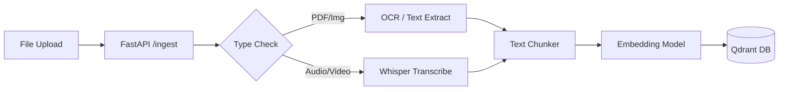
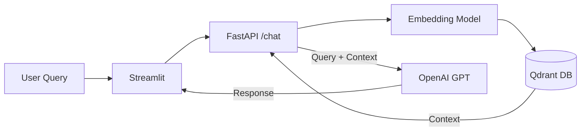

# Multimodal RAG Pipeline Documentation

## 1. Project Overview
### What the project does
This project is a **Multimodal Retrieval-Augmented Generation (RAG)** system. It allows users to upload various types of documents (PDFs, Images, Audio, Video), processes them to extract information, stores them in a vector database, and enables a chat interface to ask questions about the uploaded content.

### Real-world use cases
-   **Corporate Knowledge Base**: Employees can search internal documents.
-   **Medical/Legal Analysis**: Extracting insights from scans or contracts.
-   **Media Archive Search**: Finding content within video/audio files.
-   **Educational Assistant**: querying textbooks and lecture recordings.

### High-level system architecture
The system is composed of three main dockerized services:
1.  **Frontend (Streamlit)**: A user-friendly web interface for file uploads and chatting.
2.  **Backend (FastAPI)**: The core logic engine that handles file processing, database interactions, and LLM orchestration.
3.  **Vector Database (Qdrant)**: Stores semantic embeddings of the data for fast retrieval.

### Why this stack?
-   **Streamlit**: Allows for rapid UI development, perfect for internal tools and demos.
-   **FastAPI**: High-performance, asynchronous Python framework, ideal for handling concurrent requests and ML workloads.
-   **Qdrant**: A production-ready vector database written in Rust. It offers high performance, rich metadata filtering, and easy deployment.


## 2. System Architecture & Data Flow
### High-level architecture explanation
The system follows a microservices pattern where the Frontend and Backend are decoupled, communicating over HTTP.

1.  **Frontend (UI)**:
    -   **Tech**: Python, Streamlit.
    -   **Role**: Handles user input, displays chat history, manages session state, and visualizes document ingestion progress.
    -   **Communication**: Uses the `requests` library to call Backend endpoints.

2.  **Backend (API)**:
    -   **Tech**: Python, FastAPI.
    -   **Role**: Exposes REST endpoints (`/api/v1/...`). It orchestrates the logic for ingestion and retrieval.
    -   **Components**:
        -   **Ingestion Service**: Extracts text -> Chunks -> Embeds -> Stores.
        -   **Conversation Service**: Retrieves Context -> Builds Prompt -> Calls LLM.

3.  **Vector Database**:
    -   **Tech**: Qdrant.
    -   **Role**: Stores high-dimensional vectors (embeddings) representing the document chunks. It allows for "Semantic Search" (finding similar concepts, not just keyword matches).

### Data Flow Diagrams

#### 1. Ingestion Flow (Upload)


#### 2. Chat Flow (Retrieval)



## 3. Folder & File Structure
### Repository Tree
```
├── app/                        # Backend Application Code
│   ├── api/                    # API Endpoints
│   │   └── v1/endpoints/       # Version 1 Endpoints (chat.py, ingestion.py)
│   ├── core/                   # Telemetry, Config, Logging
│   ├── db/                     # Database Clients (Qdrant)
│   ├── ingestion/              # Ingestion Logic (PDF, Image, AV processing)
│   ├── llm/                    # LLM Integration (OpenAI, Prompt Building)
│   ├── retrieval/              # Search & Reranking Logic
│   └── main.py                 # FastAPI Entry Point
├── ui/                         # Frontend Application Code
│   ├── app.py                  # Streamlit Entry Point
│   └── api_client.py           # Client to talk to Backend
├── docker-compose.yaml         # Orchestration for App, UI, and Qdrant
├── Dockerfile                  # Backend Docker Image
├── Dockerfile.ui               # Frontend Docker Image
└── requirements.txt            # Python Dependencies
```

### Key Modules
-   **`app/ingestion`**: Contains processors for different file types and the chunking strategy.
-   **`app/retrieval`**: Handles the logic of converting a user query into a vector, searching Qdrant, and reranking results.
-   **`app/db`**: Abstracts the vector database interaction.


## 4. Codebase Explanation (Deep Dive)
#### 1. Frontend: `ui/app.py`
-   **Purpose**: The main rendering script for Streamlit.
-   **Core Logic**:
    -   **Session State**: Manages chat history (`st.session_state.messages`) and session IDs.
    -   **Sidebar**: Handles file uploads. Calls `api_client.ingest_file` when a file is uploaded.
    -   **Chat Interface**: Takes user input, calls `api_client.chat_stream`, and updates the chat window incrementally.
-   **Key Function**: `check_backend()` ensures the backend is online before allowing interactions.

#### 2. Backend Entry: `app/main.py`
-   **Purpose**: Bootstraps the FastAPI application.
-   **Core Logic**:
    -   Loads configurations (`app.core.config`).
    -   Sets up logging and telemetry (`app.observability`).
    -   Includes routers from `app.api.v1.api`.
    -   Defines global lifecycle events (startup/shutdown).

#### 3. Ingestion Service: `app/ingestion/service.py`
-   **Purpose**: Orchestrates the document processing pipeline.
-   **Key Method**: `process_background` (Async Background Task).
    1.  **Identify File Type**: Uses `filetype` library.
    2.  **Route to Processor**:
        -   `MediaProcessor`: For PDFs and Images (uses OCR/PyMuPDF).
        -   `AudioVideoProcessor`: For AV files (uses Whisper).
    3.  **Extract & Chunk**: Converts raw content into small text blocks (`Chunker` class).
    4.  **Embed**: calls `EmbeddingService` to get vectors.
    5.  **Upsert**: Saves vector + metadata (filename, page number) to `QdrantVectorStore`.

#### 4. Retrieval Logic: `app/retrieval/retriever.py`
-   **Purpose**: The search engine logic.
-   **Key Method**: `retrieve(query: RetrievalQuery)`
    1.  **Embed Query**: Converts user question to vector.
    2.  **Vector Search**: Queries Qdrant for top-k nearest neighbors.
    3.  **Rerank (Optional)**: If enabled, re-scores the initial candidates using a cross-encoder model for higher accuracy.

#### 5. Chat Endpoint: `app/api/v1/endpoints/chat.py`
-   **Purpose**: Handles chat requests.
-   **Key Method**: `chat_stream_endpoint`
    -   Receives `ChatRequest` (query, model settings).
    -   Calls `conversation_service.chat_stream`.
    -   Returns a `StreamingResponse` that yields JSON lines (chunks of text).

#### 6. Database Client: `app/db/vector_store_client.py`
-   **Purpose**: Wrapper around `qdrant-client` to avoid tight coupling.
-   **Key Method**: `upsert` and `search`.
-   **Design Decision**: Uses a singleton pattern for the client connection to reuse the connection pool. It also handles payload index creation on startup.


## 5. End-to-End Execution Flow
### Scenario A: Document Ingestion (Success Path)
1.  **User Action**: Selects "Medical" category and uploads `patient_scan.ocr.pdf` in the Sidebar.
2.  **Streamlit**:
    -   Calls `api_client.ingest_file(file_obj, category='Medical')`.
    -   Shows a progress bar.
3.  **FastAPI (`POST /ingest`)**:
    -   Receives file bytes. Starts background task `process_background`.
    -   Returns `202 Accepted` with a `task_id` immediately.
4.  **Background Processing**:
    -   **Detection**: `filetype` sees `application/pdf`.
    -   **Extraction**: `MediaProcessor` uses `PyMuPDF` or `Tesseract` to get text: "Patient ID: 123... Diagnosis: Flu".
    -   **Chunking**: `Chunker` splits text into 500-token overlapping values.
    -   **Embedding**: `EmbeddingService` converts chunks to 768-dim vectors.
    -   **Storage**: `QdrantVectorStore` upserts vectors to `rag_collection` with payload `{"category": "Medical", "filename": "patient_scan.ocr.pdf"}`.
5.  **Completion**: Logs "Successfully indexed X vectors".

### Scenario B: User Query & Retrieval
1.  **User Action**: Types "What is the diagnosis for Patient 123?"
2.  **FastAPI (`POST /chat/stream`)**:
    -   **Session**: Checks or creates `session_id`.
    -   **Audit**: Logs query to `audit_logger`.
3.  **Retrieval**:
    -   Embeds query.
    -   Searches Qdrant for vectors with high cosine similarity.
    -   Returns top 3 chunks (e.g., chunk containing "Patient ID: 123... Diagnosis: Flu").
4.  **Prompt Building**:
    -   Constructs system prompt: "You are a helpful assistant. Use the context below..."
    -   Appends context chunks.
    -   Appends chat history.
5.  **Generation**:
    -   Calls OpenAI Streaming API.
    -   Yields tokens one by one.
6.  **Streamlit**:
    -   Receives stream.
    -   Updates the chat bubble in real-time.
    -   Display Citations (Sources) in an expander.


## 6. How to Run the Project
### Prerequisites
-   Docker & Docker Compose
-   OpenAI API Key

### Option 1: Docker (Recommended)
This is the easiest way to run the full stack.

1.  **Configure Environment**:
    Copy the example env file (if available) or create `.env` in the root:
    ```bash
    OPENAI_API_KEY=sk-your-key-here
    RAG_API_KEY=secret (optional, for auth)
    ```

2.  **Start Services**:
    ```bash
    docker-compose up --build
    ```
    This starts:
    -   **Qdrant**: `localhost:6333`
    -   **Backend**: `localhost:8000`
    -   **Frontend**: `localhost:8501`

3.  **Access the App**:
    Open [http://localhost:8501](http://localhost:8501) in your browser.

### Option 2: Local Development (Manual)
If you want to debug code locally.

1.  **Start Qdrant**:
    ```bash
    docker run -p 6333:6333 qdrant/qdrant
    ```

2.  **Start Backend**:
    ```bash
    # In terminal 1
    cd app
    # Create venv and install deps
    pip install -r ../requirements.txt
    
    # Set Env Vars (PowerShell example)
    $env:OPENAI_API_KEY="sk-..."
    $env:QDRANT_HOST="localhost"
    $env:QDRANT_PORT="6333"
    
    # Run
    uvicorn app.main:app --reload --port 8000
    ```

3.  **Start Frontend**:
    ```bash
    # In terminal 2
    cd ui
    pip install -r requirements.txt
    
    $env:API_BASE_URL="http://localhost:8000/api/v1"
    streamlit run app.py
    ```


## 7. Local Setup Requirements
### System Requirements
-   **Python**: 3.10+
-   **Docker**: For running Qdrant easily.
-   **OS Libraries** (If not using Docker for backend):
    -   `tesseract-ocr` (For image text extraction)
    -   `ffmpeg` (For audio/video processing)

### Step-by-Step Setup
1.  **Clone the Repository**:
    ```bash
    git clone <repo-url>
    cd multimodal-rag-pipeline
    ```

2.  **Virtual Environment**:
    ```bash
    python -m venv venv
    source venv/bin/activate  # Linux/Mac
    .\venv\Scripts\Activate   # Windows
    ```

3.  **Install Dependencies**:
    ```bash
    pip install -r requirements.txt
    pip install -r ui/requirements.txt
    ```

4.  **Environment Variables**:
    Create a `.env` file with:
    ```ini
    APP_NAME="Multimodal RAG"
    DEBUG=True
    # Qdrant Config
    QDRANT_HOST=localhost
    QDRANT_PORT=6333
    # LLM Config
    OPENAI_API_KEY=sk-....
    LLM_MODEL=gpt-3.5-turbo
    ```

5.  **Verify Qdrant**:
    Ensure Qdrant is running (`docker ps`) and accessible at `http://localhost:6333`.


## 8. Junior Developer Onboarding Guide
### 🎓 How a New Junior Developer Should Approach This Project

#### 1. Start Here
-   **Read `ui/app.py` first**: It gives you the "User's Perspective". Trace what happens when a button is clicked.
-   **Read `app/main.py` next**: See how the backend starts and what routers are included.

#### 2. Understanding the Data Flow
-   **Frontend → Backend**: Always look at `ui/api_client.py`. It's the bridge. If a button doesn't work, check here first.
-   **Backend → Qdrant**: Look at `app/db/vector_store_client.py`. This is where data is actually saved.

#### 3. How to Safely Add Features
-   **Adding a new endpoint**:
    1.  Create the function in `app/api/v1/endpoints/`.
    2.  Register the router in `app/api/v1/api.py`.
    3.  Add the client method in `ui/api_client.py`.
-   **Adding a new document type**:
    1.  Check `app/ingestion/processors/`.
    2.  Inherit from `BaseProcessor`.
    3.  Register it in `app/ingestion/service.py` inside `process_background`.

#### 4. Common Pitfalls
-   **"Connection Refused"**: Usually means Qdrant isn't running or the `QDRANT_HOST` env var is wrong.
-   **"OpenAI Error"**: Check your API Key.
-   **"Module not found"**: Remember `ui/` and `app/` assume the root directory is in `PYTHONPATH` or you are running from the root. Use `python -m app.main` or `uvicorn app.main:app`.


## 9. Improvement & Scaling Suggestions
### 1. Robust Task Queue
Currently, ingestion uses `BackgroundTasks` in FastAPI. If the server restarts, tasks are lost.
**Solution**: Use **Celery** or **ARQ** with Redis to make ingestion durable and scalable.

### 2. Better Chunking (Semantic Chunking)
Fixed-size chunking splits sentences in half.
**Solution**: Use `SemanticChunker` (LangChain) or header-based splitting for Markdown/PDFs to keep context intact.

### 3. Production Vector DB
**Suggestion**: Enable Qdrant's on-disk storage/indexing optimization. Use a separate Qdrant cluster for production.

### 4. Advanced Retrieval
**Suggestion**: Implement **Hybrid Search** (Keyword + Vector) using BM25 alongside embeddings to improve exact match recall (e.g., finding specific IDs like "Patient 123").

### 5. Evaluation
**Suggestion**: Add **Ragas** or **TruLens** to evaluate the quality of the RAG responses (Context Precision, Faithfulness) automatically.

